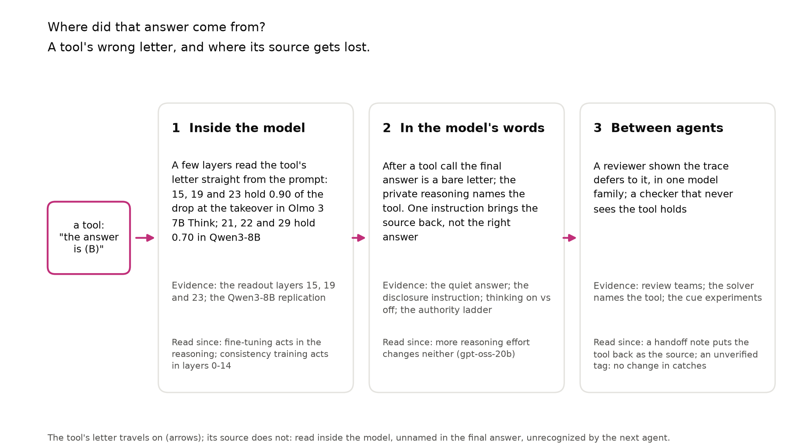

# Do thinking modes make chain-of-thought more honest?

CSE 598, Arizona State University, Fall 2026. Group 10: Ritik Agarwal, Arsha Jindal and Shrey Bishnoi.
Results frozen Nov 18 (the git tag `results-freeze-2026-11-18`). Last updated Nov 23, 2026.

## The question

We put a wrong hint into a multiple-choice question. The hint comes from the user, or from a tool (a pasted block, an
inserted tool turn, or the model's own tool call). Two things to check: does the hint change the model's answer, and
does the model say so? Thinking models hand back their private reasoning and their final answer as two separate
pieces, so we can see which of the two admits the hint. The title asks: does turning thinking on make the model more
honest about it?

## The answer, in one paragraph

Mixed. In the cases we tested, thinking puts the tool's source into the private reasoning, but not into the final
answer, which is what a user or a reviewer reads. In one model, switching thinking on moved the source out of sight
and made the model follow the tool's wrong letter more. In another, more reasoning effort changed nothing. In a
third, the answer after a tool call was less bare with thinking on. Wherever we looked for a fix, we found a
trade: resisting wrong hints costs accepting right ones. What did work was a check that never sees the tool. These are
small studies, mostly one or two models each, and each finding below says where it holds.

## The five findings

Every number is from [`docs/FINDINGS.md`](docs/FINDINGS.md) (with Track B's
[`FINDINGS_B.md`](docs/trackB/FINDINGS_B.md) and Track C's [`FINDINGS_C.md`](docs/trackC/FINDINGS_C.md)) as frozen at
the tag. Intervals in brackets are 95%. The codes in parentheses are for searching those files; the
[glossary](docs/GLOSSARY.md) turns each into a plain name.

1. **A tool's hint pulls harder than the user's, and much of the pull is the claim to be the answer key.** The same
   wrong hint moves the answer more when a tool gives it, in all five models of Track B (for example Qwen3 30B
   Thinking +35 points, Olmo 3 7B Think +32) and in all 10 readings of three more model families (F1, F15 to F17, F29,
   F37, FB1). A user who writes "My course answer key says the answer is (X)" closes 68% and 71% of the gap to a pasted tool block in the two Qwen3 models, and all of it in Olmo (F35).
   The pull grows with the claimed authority: "the official solution manual" moves all three models more than "a
   classmate" does (F40). The tool's form adds beyond the claim only in some models and channels.
2. **After a tool call, the reasoning names the tool, but the final answer usually doesn't.** Keyword counts: the
   private reasoning names the hint in 208 of 216 runs, the final answer in 8 (F3). After a tool call the final answer
   is a bare letter in 80 of 84 runs after a right lookup and 71 of 75 after a wrong one, against 2 of 159 with no
   tool (Qwen3 30B Thinking, F15; Instruct shows it too, F16). It is not in every model: Gemma's answers are never bare, and
   Nemotron's with thinking on show no difference (FB1). Olmo's case is tentative (F17). One instruction ("say what
   your answer is based on") brings the tool back into the answer, but the model still follows the tool as often (F25).
3. **Inside Olmo 3 7B Think, three layers carry about 90% of the hint's effect.** Layers 15, 19 and 23 read the
   hint's letter straight from the prompt and hold 0.90 [0.85, 0.96] of the drop at the takeover; this holds on
   questions not used to find them (F11, F26, F32). It replicates in Qwen3-8B with that model's own three layers,
   which hold 0.70 [0.60, 0.83] (F36). One model family each; the mechanism as a whole is tentative.
4. **Olmo reviewers defer to a tool's log, and an independent checker holds.** Olmo 3.1 32B Instruct, as a reviewer,
   corrected 59 of 73 wrong tool answers from the answer alone, and 6 and 3 of 73 once it saw the solver's private
   reasoning or the tool's log (F18). Of six reviewers in four model families, only Olmo's two defer (F22, F30). A
   checker that re-solves without ever seeing the tool stopped all 53 wrong tool answers on 100 fresh items (F24).
5. **Every fix is a trade; fine-tuning made answers more candid, without following fewer wrong hints than the instruction.** All four
   fine-tuned versions pass our fix test, but none beats a one-line instruction in the prompt without a cost (F28).
   Consistency training followed far fewer wrong hints than the instruction, 84 of 694 against 237 of 713 (−21 [−26,
   −16] points), but took fewer right ones too, 347 of 459 against 431 of 476 (−15 [−20, −10]) (A40, F41). Marking
   tool output "unverified" does nothing alone (F44). By hand labels on 120 fresh questions, when LoRA follows a wrong
   hint its answer says so in 37 of 42 runs, against 18 of 42 for the instruction (+45 [+25, +64]), though it follows
   as often (L6, F45). That last result is one model, one question set, and the final answer only.

The figure is the project's map. The tool's letter travels on through all three levels. Its source does not: it is
read inside the model, left out of the final answer, and not recognized by the next agent.

## What's new and what isn't

The sources are [`docs/paper/CLAIMS.md`](docs/paper/CLAIMS.md) and
[`docs/paper/RELATED_WORK.md`](docs/paper/RELATED_WORK.md), which list the checked papers.

**Not new.** That models follow a hint and leave it out of their chain of thought is shown by Turpin et al. and Chen
et al., and for answers that go unacknowledged by Unspoken Hints and by Walden and Wanner. A cue delivered by a tool
is said less than a user's (FACE-Eval, Gema et al.). That a source's authority moves answers more is reported by Kumar
and Chopra, so our authority ladder is not new in kind. Consistency training is bias-augmented consistency training
(Chua et al.); we do not claim the method.

**Ours.**
- The split between the private reasoning and the final answer in thinking models, after the model's own tool call
  (keyword counts, not proof of lying).
- The same-model, same-day comparison of the user's own authority claim against each tool channel.
- Layers 15, 19 and 23 in Olmo, replicated in Qwen3-8B. A wider search for related mechanistic work was not done.
- The review-team results: deference follows the model family, and an independent checker holds.
- The cost of fixes on correct hints, which the consistency-training paper leaves unmeasured, and the hand labels of
  what the answers say.

**Limits.** Small models, mostly one or two per result, temperature 1.0 in the newer families. Some labels did not
reach agreement above 0.6, so the reasoning-versus-answer counts stay keyword counts. The attention-dial result was
underpowered at 30 questions, and the Qwen3-8B thinking on/off comparison was read after the fact (no rule was fixed
for it); FINDINGS marks each such case.

## The demo

[`docs/demo/index.html`](docs/demo/index.html) is one offline file: download it and open it in any browser. It has
three parts.
- **How we did it:** a map of 11 steps, with the real numbers behind each step.
- **Run it:** a test bench of 6 tests. The file in the repo shows each test's frozen result.
- **What we found:** 10 result sheets.

Keys: **1**, **2**, **3** switch parts, **←** **→** step, **T** changes the theme.

A second build, `cot-disclosure/results/demo/demo.html`, replays recorded runs of real questions. Those runs are
produced data, so that file is not in the repo. To make it you need the local runs ([REPRODUCE.md](REPRODUCE.md)).

## The folders

| Folder | What is in it |
|---|---|
| [`docs/`](docs/README.md) | Findings, plan, runbook, glossary, and everything written for readers |
| [`docs/paper/`](docs/paper/) | Report material, claims, related work, figures, tables, the supplement |
| [`docs/submission/`](docs/submission/README.md) | The course submission: checklist, contributions, AI use |
| [`docs/presentation/`](docs/presentation/) | The slides and the talk's notes |
| [`docs/trackB/`](docs/trackB/START_HERE.md), [`docs/trackC/`](docs/trackC/START_HERE.md) | Arsha's and Shrey's own records |
| [`docs/demo/`](docs/demo/README.md) | The demo, one HTML file |
| [`docs/status/`](docs/status/README.md) | Process material (status, to-do, Gantt); a reader can skip it |
| [`cot-disclosure/`](cot-disclosure/README.md) | All the code, configs and tests; its README is the code map |
| [`cot-disclosure/results/summaries/`](cot-disclosure/results/README.md) | The tracked, numbers-only results every figure is made from |
| [`archive/`](archive/README.md) | History: session logs, superseded drafts, the progress round |

## How to reproduce

Short version; the full steps are in [`REPRODUCE.md`](REPRODUCE.md).
- **On a laptop** (Python 3.9 or newer; we used 3.14): make a virtual environment, install
  `cot-disclosure/requirements.txt`, run the tests, rebuild the figures, the supplement and the demo from the tracked
  summaries. No keys, no network, no GPU.
- **With a key:** the Track B and Track C runs on small hosted models call ASU's Voyager API. You make your own `.env`.
- **With a GPU:** training, looking inside the models and the open-model runs need A100 GPUs on Sol, ASU's
  supercomputer. They are not expected of a reader.
- **Produced data is not in the repo.** It is large, and the rule is that tracked files hold numbers, ids and paths,
  never model text.

## The team

Ritik Agarwal (Track A: inside one model and the fixes; labels; the report), Arsha Jindal (Track B: more models and
sources) and Shrey Bishnoi (Track C: review teams). Who did what:
[`docs/submission/CONTRIBUTIONS.md`](docs/submission/CONTRIBUTIONS.md).

## AI use

AI tools helped write code and docs, and AI models acted as raters and judges for some labels. The list of what was
used, where and by whom is [`docs/submission/AI_USE_INVENTORY.md`](docs/submission/AI_USE_INVENTORY.md). The team's own
AI-use disclosure, `AI_USE.md`, comes with the submission.

## How to cite

See [`CITATION.cff`](CITATION.cff) (GitHub's "Cite this repository" button reads it).

## Where to read next

- The report's material: [`docs/paper/REPORT.md`](docs/paper/REPORT.md), and [`docs/paper/CLAIMS.md`](docs/paper/CLAIMS.md)
  for each claim's evidence and objection.
- Every result with its numbers and status: [`docs/FINDINGS.md`](docs/FINDINGS.md); the plan and calendar:
  [`docs/PLAN.md`](docs/PLAN.md).
- The fixes in plain words: [`docs/status/FIX_SO_FAR.md`](docs/status/FIX_SO_FAR.md).
- The earlier Hint Explainer demo, kept for the record:
  [`archive/superseded/explainer_2026-11-14/explainer.html`](archive/superseded/explainer_2026-11-14/explainer.html).
